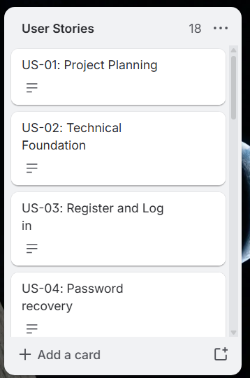
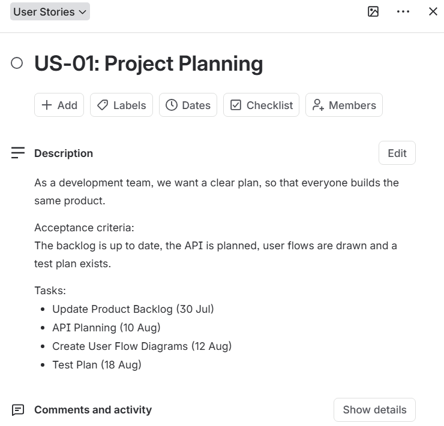
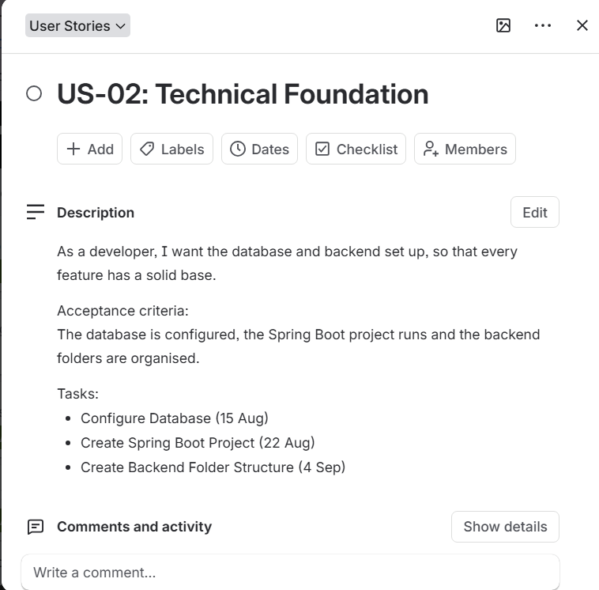

#  Hi, I'm Qhubekani Shandu
 Hanover, Cape Town, South Africa  
 231316267@mycput.ac.za  
 066 535 8670  
 [GitHub Profile Evidence](https://github.com/Qhubeka0501)  
 [LinkedIn](https://www.linkedin.com/in/qhubekani-shandu-b683a93a2/)  

--- 

## Profile

Proactive and detail-oriented ICT professional with practical experience in data extraction, cleaning, and visualization. Skilled at supporting operational systems and enhancing data accuracy to facilitate informed decision-making. Seeking to contribute technical expertise and analytical skills in a dynamic and growth-oriented environment.

---

##  Education

- **Diploma in Information and Communication Technology**  
  Cape Peninsula University of Technology (2024 – Present)

- **National Senior Certificate**  
  (2022)

---

##  Technical Skills

- Java  
- Python  
- JavaScript  
- React.js  
- Data Analytics  
- Data Analysis  
- Microsoft Excel (PivotTables, formulas, charts)  
- Power BI & Tableau  
- Apache Derby (SQL)  
- Java Swing  

---

##  Work Experience

###  Data Support Assistant  
**Cyngatha Restaurant** (Oct 2024 – Feb 2026)

- Maintained POS system data ensuring accurate daily transaction reporting  
- Extracted, cleaned, and analyzed sales data using Excel  
- Identified sales trends to support inventory planning  
- Provided technical and data-related support to staff  

---

###  Undergraduate Volunteer ICT Tutor  
**Sandernburg Residence** (Feb 2025 – Present)

- Tutored beginner students in programming concepts and tools  
- Assisted with software, hardware, and networking fundamentals  
- Supported first-year students through tutoring sessions  

---

##  Evidence of Learning (Artefacts)

### Project: E-commerce App (Java)
**Description:**  
This project involved developing a Java-based e-commerce application that allows users to browse and purchase products.

**What I learned:**  
- Object-Oriented Programming (OOP) principles  
- Handling user input and validation  
- Structuring a multi-class application  

---

###  Project: Calculator App (Java Swing)
**Description:**  
A GUI-based calculator that performs basic arithmetic operations using Java Swing.

**What I learned:**  
- GUI design using Java Swing  
- Event handling  
- Improving user interaction  

---

##  Mock Interview

**Description:**  
A recorded mock interview demonstrating my communication and professional skills.

**What I learned:**  
- Improved confidence  
- Better communication skills  
- How to answer interview questions effectively  

 [Watch My Mock Interview](https://drive.google.com/file/d/1SfHqxFqcLyNTMiTNp1_CHx9HJvHTreS2/view?usp=sharing)

# Reflection on Markdown.

**Situation:**  
I was required to create a digital portfolio using GitHub Markdown.

**Task:**  
My task was to design and present my CV in a structured and professional format using Markdown.

**Action:**  
I used Markdown features such as headings, lists, links, and formatting to organise my portfolio clearly. I also ensured that my information was easy to read and visually appealing.

**Result:**  
I improved my technical documentation skills and learned how to present information in a professional format using GitHub. This skill will help me in future projects and collaboration.

---

# Reflection on Mock Interview 

**Situation:**  
I participated in a mock interview as part of my work readiness training.

**Task:**  
My task was to prepare for and respond to interview questions professionally.

**Action:**  
I practiced answering common interview questions, focused on communication skills, and maintained confidence during the interview.

**Result:**  
I improved my confidence, communication, and ability to present myself professionally. I also identified areas where I need improvement, such as answering questions more clearly and confidently.

---

# Reflection on GitHub Pages 

**Situation:**  
I was required to publish my digital portfolio using GitHub Pages.

**Task:**  
My task was to deploy my GitHub repository as a live website.

**Action:**  
I configured GitHub Pages through the repository settings and selected the main branch for deployment.

**Result:**  
I successfully published my portfolio online, making it accessible to others. I gained experience in web deployment and improved my understanding of GitHub tools.

# PRP370S Assessment 2 – Agile Portfolio Evidence

## Agile Team Charter

### Evidence

The Agile Team Charter was developed for the LaunchPad.dev project to establish the team's shared purpose, roles, responsibilities, working agreements, communication methods and Agile practices.

Our team used the Kanban methodology supported by Trello to organise tasks, monitor progress and manage the project workflow.

📄 [View Full Agile Team Charter](evidence/Agile%20Team%20Charter%20%281%29PDF.pdf)

### Reflection

Developing and working with the Agile Team Charter helped me understand the importance of establishing clear roles, responsibilities and working agreements before starting a project. As a Developer and Research Lead, I understood what was expected from me and how my responsibilities contributed to the overall LaunchPad.dev project.

I also learned how Agile practices such as daily stand-ups, sprint planning, reviews and retrospectives help teams communicate, identify problems early and continuously improve. The charter helped create accountability within the team and gave us a shared understanding of how we would work together throughout the project.

## User Stories and Tasks

### Evidence

The following Trello board evidence shows the user stories created for the LaunchPad.dev project. The user stories were used to describe system requirements from the user's or development team's perspective and were broken down into specific tasks.

#### User Stories Overview

The User Stories column in Trello was used to organise the different requirements and features planned for the project.

#### US-01: Project Planning

This user story focused on creating a clear development plan for the team. It included acceptance criteria and tasks such as updating the Product Backlog, API planning, creating user flow diagrams and preparing the test plan.

#### US-02: Technical Foundation

This user story focused on establishing the technical foundation of the system. The tasks included configuring the database, creating the Spring Boot project and organising the backend folder structure.

### Reflection

Working with user stories helped me understand how project requirements can be translated into smaller and more manageable development tasks. Instead of approaching the system as one large project, each user story provided a clear objective, acceptance criteria and a set of tasks that needed to be completed.

I also learned that user stories improve communication within an Agile team because team members can clearly understand what needs to be developed and why it is required. Breaking the stories into individual tasks made it easier to plan the work, monitor progress on Trello and connect each task to the overall goals of the LaunchPad.dev project.

##  References

**Mr L. Mchunu**  
Cyngatha Manager  
 060 745 6335  
 lindokuhlelindo.mchunu03@gmail.com  

**Mr M.N. Ngema**  
Sandernburg Assistant  
 076 515 8192  
 mnqobingema23@gmail.com  

---
